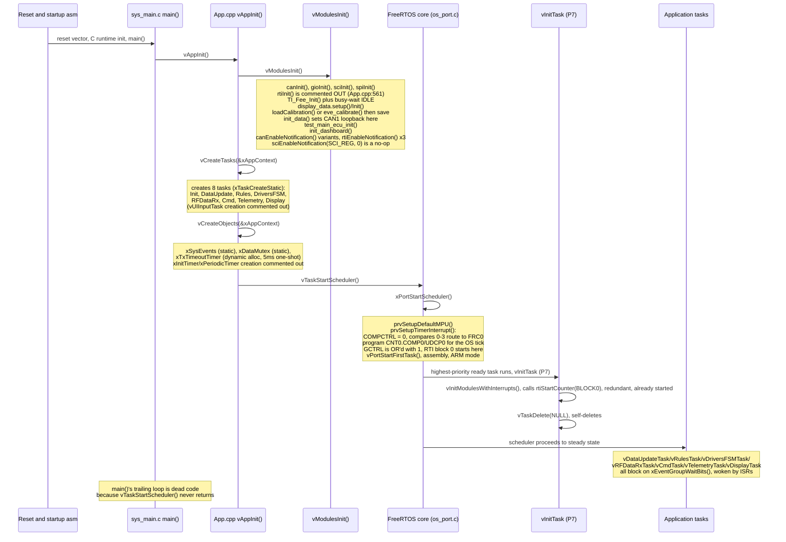
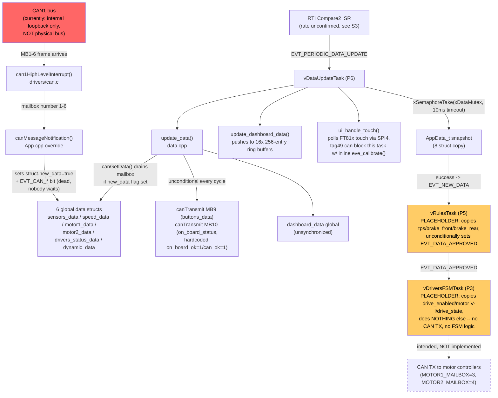
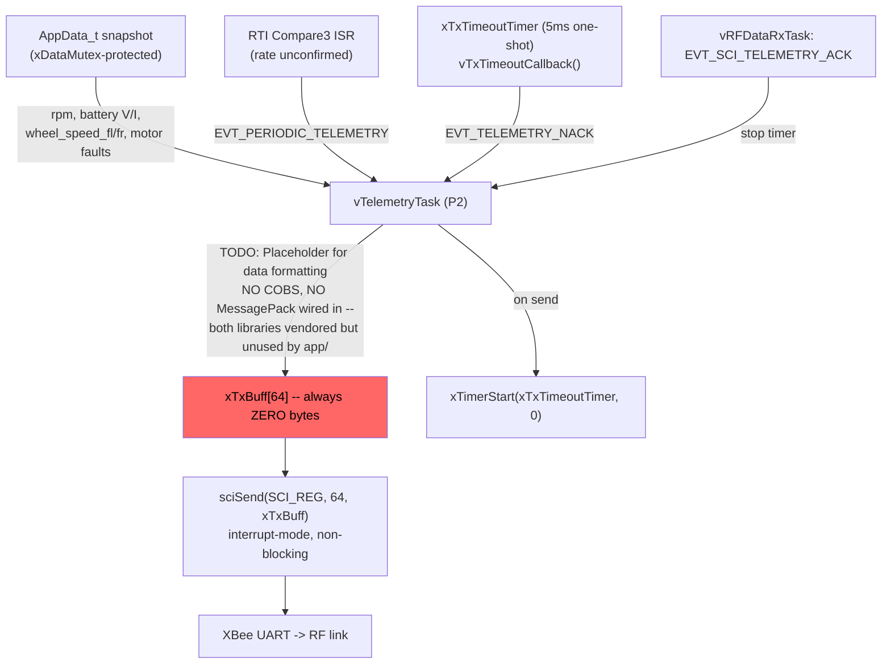
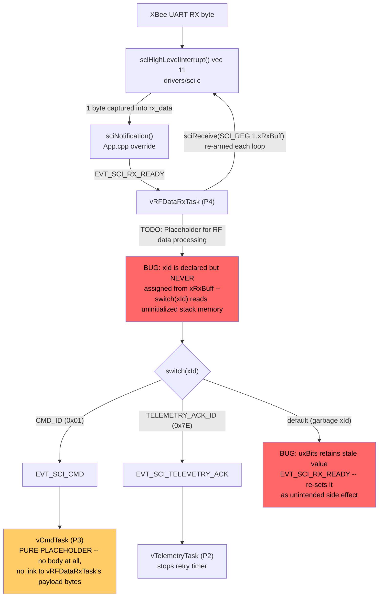
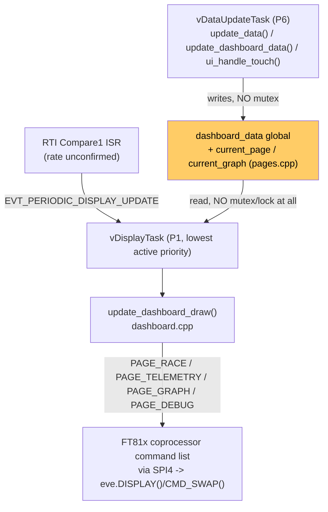
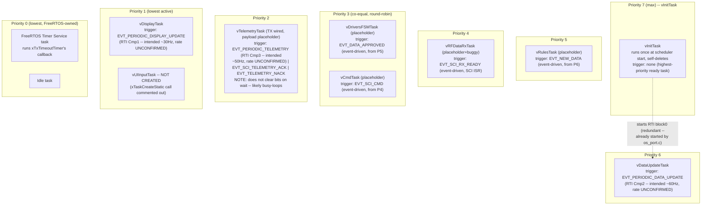

# Main ECU Firmware — System Architecture

**Repository:** `tms570_freertos`
**Scope:** describes the firmware as it exists in the source tree today, not the intended final design. Placeholder, disabled, and buggy behavior is called out explicitly rather than smoothed over. Every non-obvious claim carries a `file:line` citation; where a fact could not be established from the source alone it is marked **unconfirmed**.

---

## 1. Overview

This repository is the firmware for the **Main ECU** of a Formula-Student-style electric race car, running **FreeRTOS** on a **TI TMS570LS1224** (ARM Cortex-R4F, lockstep safety MCU). The firmware's designed role is to: ingest sensor and motor-controller data over **CAN1**, apply a safety/compliance gate before any actuation, drive a **motor control state machine**, transmit **telemetry over an XBee RF link** (SCI/UART), receive remote commands over the same link, and render a **touchscreen dashboard** (Bridgetek FT81x over SPI4) with four pages (race view, telemetry grid, historical graphs, debug/calibration).

Architecturally the skeleton is complete and coherent: nine FreeRTOS tasks communicate through a single event group and a mutex-protected data snapshot, all statically allocated. Functionally, only two of the nine tasks are fully implemented end-to-end (CAN ingestion/touch handling, and display rendering); the safety-gate, motor FSM, RF command processing, and telemetry payload serialization are placeholders or contain concrete bugs, and CAN1 is currently configured in internal loopback (self-test) mode rather than talking to a physical bus. These gaps are documented in detail in [§9 Known Issues](#9-known-issues--open-questions).

---

## 2. Hardware & Peripheral Map

| Peripheral | Role | Configured by | Used by | Status |
|---|---|---|---|---|
| **CAN1** (`canREG1`) | Vehicle bus: sensors, motor controllers, driver buttons/status | `canInit()` (`drivers/can.c:84`) — initializes **message objects 1–6 only** | `vDataUpdateTask` (drain 1–6, transmit on 9/10 via `update_data()`), `canMessageNotification()` ISR | **In internal loopback** — `canEnableloopback(canREG1, Internal_Lbk)`, `app/data.cpp:20`, invoked from the live `init_data()` call in `vModulesInit()` (`app/App.cpp:591`). Cannot see real bus traffic today. Mailboxes 9/10 (buttons/status) and 17–22 (bench-test simulator) are used by application code but never initialized by `canInit()`. |
| **SCI/UART** (`sciREG`) | XBee RF link, 115200 baud | `sciInit()` (`drivers/sci.c:74`, HALCoGen default `BRS=42`), overridden by `sciSetBaudrate(sciREG, 115200)` from `init_data()` (`app/data.cpp:19`, `drivers/sci.c:193`) | `vRFDataRxTask` (`sciReceive`, 1 byte at a time), `vTelemetryTask` (`sciSend`, always 64 zero bytes), `sciNotification()` ISR callback | TX/RX plumbing wired and interrupt-driven (non-blocking). Not in loopback. Framing/overrun/parity/wake/break interrupts reach the callback but produce no event (`app/App.cpp`'s `sciNotification()` override has no case for them). |
| **SPI4** (`spiREG4`) | FT81x display + resistive touch controller | `spiInit()` (`drivers/spi.c`) — RX-buffer-full interrupt on by default, TX interrupt off | `Bridgetek_EVE2 display_data` object, used throughout `app/dashboard.cpp` / `app/ui_touch.cpp`; polled from `vDataUpdateTask` (touch) and `vDisplayTask` (draw/flush) | `spiNotification`/`spiEndNotification` are unoverridden empty weak stubs (`halcogen/notification.c`); whether the FT81x driver depends on them (interrupt-mode transfers) or uses blocking/polling SPI calls is **unconfirmed** (`ft81x_driver/` not audited in depth). |
| **RTI** (`rtiREG1`) | FreeRTOS OS tick (Compare 0, Block 0) + intended periodic app ticks (Compares 1–3, nominally 30/60/50 Hz) | OS tick: `rtos/os_port.c:373-400` (`prvSetupTimerInterrupt()`), runs at scheduler start, before any task. App compares 1–3: **rate never actually programmed** — `rtiInit()` (`drivers/rti.c:74`) is never called; only `rtiEnableNotification()` (interrupt-enable, not rate) runs, 3× from `vModulesInit()` (`app/App.cpp:593-595`). See [§3](#3-boot-sequence) and [issue 1](#9-known-issues--open-questions). | `rtiNotification()` ISR callback (`app/App.cpp`) maps Compare1→`EVT_PERIODIC_DISPLAY_UPDATE`, Compare2→`EVT_PERIODIC_DATA_UPDATE`, Compare3→`EVT_PERIODIC_TELEMETRY` | Counter Block 0 is running (OS tick and compares 1–3 share it — confirmed, see §3). Block 1 is never started, never used. The Digital Windowed Watchdog (DWD/DWWD, also hosted in the RTI module) is entirely unarmed. |
| **GIO** | General-purpose I/O | `gioInit()` only — zeroes everything, all pins input, no interrupts | Nothing beyond the one-time init call | **Entirely unused.** All on-screen "buttons" (traction/mode/drive/telemetry) are touchscreen taps handled via SPI4/FT81x, not physical GIO pins. |
| **ti_fee** (Flash EEPROM emulation) | Persist touch calibration across power cycles | `TI_Fee_Init()` from `vModulesInit()` | `loadCalibration()`/`saveCalibration()` (`app/ui_touch.cpp`), 28-byte struct (magic + 6× `uint32_t` transform coefficients A–F), guarded by magic `0xA5A5A5A5` | Matches its documented purpose; works as intended. |
| **cobs / msgpack** (vendored libraries) | Intended serial-packet framing + payload packing for the RF link | Vendored with git submodules; `cobs/*.c` is compiled, `msgpack/src` is **explicitly excluded from the build** (`Makefile` comment: missing `sysdep.h`, "re-enable once msgpack integration is implemented") | **Nobody** — no file under `app/` includes `cobs.h`/`cobsr.h`/`msgpack.h`, or calls any `cmp_*` function (grep-confirmed) | Vendored but entirely unwired. Telemetry TX sends a zero-filled raw buffer today. |

---

## 3. Boot Sequence

The entry point is `halcogen/sys_main.c`:

```c
int main(void)
{
    vAppInit();
    for (;;)
        vAppRun();
    return 0;
}
```

`vAppRun()` is an empty stub, and `vTaskStartScheduler()` (called from `vAppInit()`) never returns under normal operation — so the `for(;;) vAppRun();` loop is unreachable dead code.

The most important fact about boot is what happens to the RTI hardware. `rtos/os_port.c:373-400` (`prvSetupTimerInterrupt()`), which runs during `vTaskStartScheduler()` — **before any application task, including the highest-priority `vInitTask`, gets CPU time** — does two things directly relevant to the periodic-event backbone:

1. `portRTI_COMPCTRL_REG = 0x00000000U;` (`os_port.c:382`) — a hardcoded write to the register that selects which free-running counter (Block 0 vs Block 1) feeds each of RTI's four compares. A value of `0x0` routes **all four compares (0–3) to Block 0**.
2. `portRTI_GCTRL_REG |= 0x00000001U;` (`os_port.c:399`) — **starts RTI counter Block 0** during scheduler startup. This is the same bit `vInitTask`'s later `rtiStartCounter(rtiCOUNTER_BLOCK0)` call (`app/App.cpp:745`) sets — by the time `vInitTask` runs, Block 0 is already counting, so that call is a redundant no-op.

Consequently, Compares 1–3 (the app's periodic display/data/telemetry ticks) run on the same live, correctly-selected counter as the OS tick and **will fire** — the failure mode once suspected (compares never firing because Block 1 is never started) does not apply. What remains genuinely unconfirmed is *the rate*: the match/reload registers that determine exact timing (`CMP[1..3].COMPx/UDCPx`) are only ever programmed by `rtiInit()` (`drivers/rti.c:74`), which is never called — its call site in `vModulesInit()` is commented out (`app/App.cpp:561`, comment: *"RTI will be started after scheduler starts"*). So `CMP[1..3]` retain whatever value silicon reset leaves them at, which this source tree does not establish. **Treat 30/50/60 Hz as the evident design intent, not a verified runtime rate.**



---

## 4. Synchronization Primitives

All application tasks share a single 32-bit `EventGroupHandle_t xSysEvents`, one mutex `xDataMutex`, and one software timer `xTxTimeoutTimer`, defined in `AppSync_t` (`app/App.cpp`) and created statically (event group, mutex) or dynamically (timer) in `vCreateObjects()` (`app/App.cpp:708-736`). There is deliberately **no queue-based IPC**: per a comment on the `AppSync_t` struct, "data is shared globally from the data and dashboard modules; tasks can just read the latest data when they receive an event flag."

### 4.1 Event group — `xSysEvents`

Bit definitions at `app/App.cpp:85-110`.

| Bit | Hex | Constant | Set by | Cleared by | Waited on by | Status |
|---|---|---|---|---|---|---|
| 0 | `0x000001` | `EVT_CAN_SENSORS` | `canMessageNotification()` ISR, MB1 | never | nobody | dead — self-acknowledged `TODO` in the ISR: *"The DataUpdate task is periodic, so EVT_CAN_x events are not necessary"* |
| 1 | `0x000002` | `EVT_CAN_SPEED` | `canMessageNotification()` ISR, MB2 | never | nobody | dead |
| 2 | `0x000004` | `EVT_CAN_MOTOR1` | `canMessageNotification()` ISR, MB3 | never | nobody | dead |
| 3 | `0x000008` | `EVT_CAN_MOTOR2` | `canMessageNotification()` ISR, MB4 | never | nobody | dead |
| 4 | `0x000010` | `EVT_CAN_DRIVERS_STATUS` | `canMessageNotification()` ISR, MB5 | never | nobody | dead |
| 5 | `0x000020` | `EVT_CAN_DYNAMIC` | `canMessageNotification()` ISR, MB6 | never | nobody | dead |
| 10 | `0x000400` | `EVT_SCI_RX_READY` | `sciNotification()` ISR, SCI RX-complete | `vRFDataRxTask`'s wait (`pdTRUE`) | `vRFDataRxTask` | live, but see the `default`-branch stray re-set bug in [§6.3](#63-rf-receivecommand-path-placeholder-buggy) |
| 11 | `0x000800` | `EVT_SCI_TX_READY` | `sciNotification()` ISR, SCI TX-complete | never | nobody | dead |
| 12 | `0x001000` | `EVT_SCI_CMD` | `vRFDataRxTask`, on `xId==CMD_ID` (unreliable, see below) | `vCmdTask`'s wait (`pdTRUE`) | `vCmdTask` | live but feeds a no-op task |
| 13 | `0x002000` | `EVT_SCI_TELEMETRY_ACK` | `vRFDataRxTask`, on `xId==TELEMETRY_ACK_ID` (unreliable) | **never explicitly** — `vTelemetryTask`'s wait uses `pdFALSE` | `vTelemetryTask` | likely busy-loop contributor, see §6.2/§9 |
| 14 | `0x004000` | `EVT_TELEMETRY_NACK` | `vTxTimeoutCallback()` timer callback | **never explicitly** (same `pdFALSE` issue) | `vTelemetryTask` | likely busy-loop contributor |
| 15 | `0x008000` | `EVT_NEW_DATA` | `vDataUpdateTask`, after mutex-protected snapshot copy succeeds | `vRulesTask`'s wait (`pdTRUE`) | `vRulesTask` | live |
| 16 | `0x010000` | `EVT_DATA_APPROVED` | `vRulesTask`, unconditionally every cycle | `vDriversFSMTask`'s wait (`pdTRUE`) | `vDriversFSMTask` | live, but approval is a rubber stamp |
| 20 | `0x100000` | `CMD_READY` | nobody (referenced only in a fully commented-out wait) | n/a | nobody | reserved/dead |
| 21 | `0x200000` | `TELEMETRY_READY` | nobody (same commented-out block) | n/a | nobody | reserved/dead |
| 25 | `0x2000000` | `EVT_PERIODIC_DATA_UPDATE` | `rtiNotification()` ISR, RTI Compare2 — fires, rate unconfirmed | `vDataUpdateTask`'s wait (`pdTRUE`) | `vDataUpdateTask` | live |
| 26 | `0x4000000` | `EVT_PERIODIC_TELEMETRY` | `rtiNotification()` ISR, RTI Compare3 — fires, rate unconfirmed | **never explicitly** (`pdFALSE`) | `vTelemetryTask` | live but see busy-loop concern |
| 27 | `0x8000000` | `EVT_PERIODIC_UI_INPUT` | nobody — `rtiNotification()`'s switch has no case producing it | n/a | nobody (`vUIInputTask`, the only plausible consumer, is never created) | dead |
| 28 | `0x10000000` | `EVT_PERIODIC_DISPLAY_UPDATE` | `rtiNotification()` ISR, RTI Compare1 — fires, rate unconfirmed | `vDisplayTask`'s wait (`pdTRUE`) | `vDisplayTask` | live |

Bits 6–9, 17–19, 22–24, 29–31 are unassigned.

### 4.2 Mutex — `xDataMutex`

`SemaphoreHandle_t`, created via `xSemaphoreCreateMutexStatic()` at `app/App.cpp:720`. Protects the `AppData_t` snapshot struct (`sensors_data`, `speed_data`, `dynamic_data`, `motor1_data`, `motor2_data`, `drivers_status_data`, `buttons_data`, `on_board_status_data`) — **not** the raw globals those fields are copied from, which `update_data()`/`ui_handle_touch()`/`update_dashboard_data()` write directly, unsynchronized.

| Taker | Call site | Timeout | Purpose |
|---|---|---|---|
| `vDataUpdateTask` | `app/App.cpp:780` | `pdMS_TO_TICKS(10)` — **not** `portMAX_DELAY` | copy 8 globals → `AppData_t` snapshot |
| `vRulesTask` | `app/App.cpp:828` | `portMAX_DELAY` | read `tps`/`brake_front`/`brake_rear` |
| `vDriversFSMTask` | `app/App.cpp:877` | `portMAX_DELAY` | read `drive_enabled`, motor 1/2 V/I, `drive_state` |
| `vTelemetryTask` | `app/App.cpp:1027` | `portMAX_DELAY` | read `rpm`, battery V/I, wheel speeds FL/FR, motor faults |

`vDisplayTask` is the only consumer that does **not** take this mutex — see [§6.4](#64-display-path-fully-implemented-rendering-unsynchronized-reads). On the `vDataUpdateTask` 10 ms timeout, the copy and `EVT_NEW_DATA` are silently skipped with no error counter or log (`app/App.cpp:780-796`).

### 4.3 Software timer — `xTxTimeoutTimer`

One-shot (`pdFALSE` auto-reload), 5 ms period, created **dynamically** via `xTimerCreate()` (`app/App.cpp:734`) — despite `AppResources_t` containing an unused pre-allocated `StaticTimer_t xTxTimeoutTimerBuffer` that would allow `xTimerCreateStatic()` instead. Runs in the FreeRTOS Timer Service task context (priority `configTIMER_TASK_PRIORITY` = 0, the lowest in the system). Started by `vTelemetryTask` after every transmission (`app/App.cpp:1051`); stopped on `EVT_SCI_TELEMETRY_ACK` (`app/App.cpp:1056`). Its callback, `vTxTimeoutCallback()` (`app/App.cpp:1129-1134`), sets `EVT_TELEMETRY_NACK` via `xEventGroupSetBits` (correctly, since timer callbacks run in task context, not an ISR).

Two other timers, `xInitTimer` and `xPeriodicTimer` (with callbacks `vInitTimerCallback`/`vPeriodicTimerCallback`), exist in code but their creation is entirely commented out (`app/App.cpp:723-731`) — dead code. `vInitTask` is the mechanism actually used for post-scheduler-start initialization instead of `xInitTimer`.

---

## 5. Tasks Reference

All nine task functions live in `app/App.cpp`. All use static allocation (`xTaskCreateStatic()`) from buffers in `AppResources_t`, created in `vCreateTasks()` (`app/App.cpp:611-706`) in this order: Init, DataUpdate, Rules, DriversFSM, RFDataRx, Cmd, Telemetry, (UIInput — skipped), Display.

### 5.1 `vInitTask` — one-shot startup

**Priority** `PRIO_INIT` = `PRIO_MAX` = 7 (highest). **Stack** 128 bytes (`STACK_INIT`). **Definition** `app/App.cpp:740-749`. **Trigger** none — it is simply the highest-priority ready task, so it runs first after `vTaskStartScheduler()`.

Body: calls `vInitModulesWithInterrupts()` → `rtiStartCounter(rtiCOUNTER_BLOCK0)` (redundant, since `rtos/os_port.c` already started Block 0 before any task ran — see §3), then `vTaskDelete(NULL)`.

**State:** fully implemented, trivial. **Inputs/Outputs:** none beyond the (redundant) hardware side effect. Deferred to a task (rather than run inline in `vAppInit()`) because interrupts must remain disabled across `vTaskStartScheduler()`; running at max priority guarantees it completes before any other application task gets CPU time.

### 5.2 `vDataUpdateTask` — CAN/touch ingestion (intended ~60 Hz)

**Priority** 6. **Stack** 512 bytes. **Definition** `app/App.cpp:751-801`. **Trigger** `EVT_PERIODIC_DATA_UPDATE` (RTI Compare2 — rate unconfirmed, §3).

Per cycle:
1. `update_data()` (`app/data.cpp:34`) — for each of 6 Rx structs whose `new_data` flag was set by `canMessageNotification()`, drains the mailbox via `canGetData()`, converts to `float` into the global `dashboard_data`. **Unconditionally**, every call: packs and transmits `buttons_data` on MB9 and `on_board_status_data` on MB10, with `on_board_ok`/`can_ok` hardcoded to `1` (comment: *"Assuming the ECU is always OK for this example"*) — not a real self-test.
2. `update_dashboard_data()` (`app/dashboard.cpp`) — pushes current scalars into 16 per-metric 256-entry history ring buffers, unsynchronized.
3. `ui_handle_touch()` (`app/ui_touch.cpp`) — polls FT81x touch registers over SPI4, dispatches the button/swipe/calibration state machine. **Tag 49 ("screen calibration") runs `eve_calibrate()` + `saveCalibration()` synchronously inline here** — a blocking, busy-wait interactive sequence plus a flash write, executing on this task's own context.
4. `xSemaphoreTake(xDataMutex, pdMS_TO_TICKS(10))` (`app/App.cpp:780`) — on success, copies all 8 global structs into the `AppData_t` snapshot and sets `EVT_NEW_DATA`. On the 10 ms timeout, silently skips with no diagnostics.

**State:** the only task in the system with a fully implemented, non-placeholder body (together with `vInitTask`/`vDisplayTask`, which are simpler).

**Bugs/concerns:** CAN1 is in internal loopback (`app/data.cpp:20`), so `canGetData()` here never sees real bus traffic — this is the most severe hardware-integration finding in the codebase. Mailboxes 9/10 are never initialized by `canInit()`, so their `MsgVal` bit may be unset (transmission plausibly silently rejected, unconfirmed). Tag-49 calibration stalls CAN ingestion, dashboard updates, and the entire `EVT_NEW_DATA → EVT_DATA_APPROVED` approval chain for its duration — a real latency concern for a nominally periodic, safety-adjacent task.

### 5.3 `vRulesTask` — compliance/safety gate (placeholder)

**Priority** 5. **Stack** 512 bytes. **Definition** `app/App.cpp:803-847`. **Trigger** `EVT_NEW_DATA`.

Copies `tps`/`brake_front`/`brake_rear` from the snapshot into a local struct (`app/App.cpp:809-815`, whose trailing `/* ... */` comment implies more fields were planned but never added), then **unconditionally** sets `EVT_DATA_APPROVED` (`app/App.cpp:838`) — no condition, no branch. The comment directly above the set even reads *"This is not needed if rule checking is periodic"* (`app/App.cpp:837`), suggesting the author saw this as a stopgap. Below it: `// TODO: Placeholder for compliance checks` (`app/App.cpp:841-843`).

**State:** placeholder. There is currently no compliance/safety gate at all between raw sensor data and actuation — approval fires every cycle regardless of sensor values.

### 5.4 `vDriversFSMTask` — motor driver state machine (placeholder)

**Priority** 3. **Stack** 1024 bytes — the largest in the system, consistent with an expectation that torque-control logic will grow substantially here. **Definition** `app/App.cpp:849-896`. **Trigger** `EVT_DATA_APPROVED`.

Copies `drive_enabled`, motor 1/2 voltage/current, and `drive_state` into a local struct, then hits `// TODO: Placeholder for driver FSM logic` (`app/App.cpp:890-892`) — nothing else happens. No CAN transmission, no state transitions, no output of any kind.

**State:** placeholder — the `drive_state_t` enum (`OFF=0, ON, FAULT`) exists and is populated elsewhere by CAN-received data, but this task, which would be the one to *act* on it (and command motor torque via `MOTOR1_MAILBOX`/`MOTOR2_MAILBOX`, mailboxes 3/4), does not exist beyond the placeholder. No motor control command path exists anywhere in the firmware today.

### 5.5 `vRFDataRxTask` — RF serial receive/dispatch (placeholder, buggy)

**Priority** 4. **Stack** 512 bytes. **Definition** `app/App.cpp:898-950`. **Trigger** `EVT_SCI_RX_READY`. **Note:** unlike every other active task's creation, this one's `xTaskCreateStatic()` call (`app/App.cpp:658-666`) has **no** `configASSERT` following it — a failed creation here would go unnoticed.

Body: arms a 1-byte interrupt-driven receive (`sciReceive(SCI_REG, 1, xRxBuff)`), waits for `EVT_SCI_RX_READY`, then dispatches on `switch (xId)`.

**State:** placeholder, and contains two confirmed control-flow bugs (not merely gaps):
- `xId` (`uint8_t xId`, `app/App.cpp:903`) is **declared but never assigned** from the received byte anywhere in the function — the `switch (xId)` reads uninitialized stack memory. This is exactly the gap the `// TODO: Placeholder for RF data processing` (`app/App.cpp:928-930`) marks, but it means dispatch is not just unimplemented, it is undefined behavior.
- On the `default` branch (garbage `xId` matching neither `CMD_ID` nor `TELEMETRY_ACK_ID`), `uxBits` still holds the value `xEventGroupWaitBits()` returned — which, since `pdTRUE` clear-on-exit already removed `EVT_SCI_RX_READY` from the group, is exactly that bit. `xEventGroupSetBits(xSysEvents, uxBits)` (`app/App.cpp:945`) therefore **re-sets `EVT_SCI_RX_READY`** as an unintended side effect. Currently harmless (silently absorbed by this same task's next wait) but a genuine logic defect.

### 5.6 `vCmdTask` — remote command processor (pure placeholder)

**Priority** 3 (co-equal with `vDriversFSMTask`; FreeRTOS resolves ties round-robin). **Stack** 512 bytes. **Definition** `app/App.cpp:966-992`. **Trigger** `EVT_SCI_CMD` (produced by `vRFDataRxTask`, subject to that task's `xId` bug).

Declares `uint8_t xRxBuff[16]` (`CMD_LENGTH`) that is never written to or read from anywhere — a dead buffer. Body is `// TODO: Placeholder for cmd processing` (`app/App.cpp:985-987`) with nothing else. **State:** pure no-op. Even once `vRFDataRxTask`'s bug is fixed, there is no data path (queue/shared buffer) carrying the actual command payload from `vRFDataRxTask`'s `xRxBuff` to this task's separate, unrelated buffer — only the event bit crosses the task boundary.

### 5.7 `vTelemetryTask` — RF telemetry transmitter (TX wired, payload placeholder; likely busy-loop bug)

**Priority** 2. **Stack** 512 bytes. **Definition** `app/App.cpp:994-1061`. **Trigger** `EVT_PERIODIC_TELEMETRY | EVT_SCI_TELEMETRY_ACK | EVT_TELEMETRY_NACK` (RTI Compare3, `vRFDataRxTask`'s ACK, or the 5 ms retry timer's NACK).

On a periodic tick or NACK: copies `rpm`, `battey_voltage` [sic, field misspelled in the struct itself], `battery_current`, wheel speeds FL/FR, and motor faults into a local struct; hits `// TODO: Placeholder for data formatting` (`app/App.cpp:1042-1044`, `xTxBuff[64]` stays all-zero); sends via `sciSend()` (non-blocking, interrupt mode); arms the 5 ms retry timer. On ACK: stops the retry timer.

**State:** TX plumbing (data collection, `sciSend`, retry timer) is real and functional; **serialization is a placeholder** — no COBS or MessagePack, both vendored but unwired (§2).

**Bugs/concerns — the most significant likely-active bug in the task layer:** the wait at `app/App.cpp:1017-1022` uses `pdFALSE` (do-not-clear-on-exit) on all three trigger bits, and **nothing anywhere in the repository ever calls `xEventGroupClearBits()` on `EVT_PERIODIC_TELEMETRY`, `EVT_SCI_TELEMETRY_ACK`, or `EVT_TELEMETRY_NACK`** (grep-confirmed). Since `xEventGroupWaitBits()` with `pdFALSE` returns immediately if a target bit is already set, once any one of these three bits is set for the first time, the wait will return instantly on every subsequent loop iteration forever after — i.e. this task very likely spins in a tight loop re-sending telemetry rather than genuinely waiting for the next tick or a real ACK/NACK, once RTI Compare3 fires even once.

### 5.8 `vDisplayTask` — dashboard renderer

**Priority** 1 (lowest active, tied with the disabled `vUIInputTask`). **Stack** 768 bytes. **Definition** `app/App.cpp:1080-1104`. **Trigger** `EVT_PERIODIC_DISPLAY_UPDATE` (RTI Compare1 — rate unconfirmed).

Body is a single call: `update_dashboard_draw(display_data, &dashboard_data)` (`app/dashboard.cpp`), which builds an FT81x coprocessor display list and branches on the global `current_page`:
- **PAGE_RACE** — RPM shift-light bar, two motor V/I/T blocks, TPS/brake widgets, 3 toggle buttons, fault/drive-state text.
- **PAGE_TELEMETRY** — a 4×4 labeled-cell grid, each cell tap-tagged to jump into `PAGE_GRAPH`.
- **PAGE_GRAPH** — scrolling line-graph of one of 16 selectable metrics, reading the corresponding 256-entry ring buffer.
- **PAGE_DEBUG** — calibration/mode-toggle buttons; the "hold-to-send" calibration countdown timers are decremented **inside this draw call**, so their real-world rate is tied to however often `PAGE_DEBUG` is actually rendered.

**State:** fully implemented for all 4 pages (rendering is not a placeholder — the *data* rendered may be stale due to the CAN-loopback issue).

**Bugs/concerns:** `vDisplayTask` is the **only** consumer task that does not take `xDataMutex` — it reads the raw `dashboard_data` global directly while priority-6 `vDataUpdateTask` writes it without a lock. For scalar floats this is a low-severity torn-read risk; the 256-entry ring buffers and `graph_buffer_index` that `PAGE_GRAPH` iterates are a slightly less benign instance of the same unreviewed race (no crash risk identified, since no pointers/lengths derive from the torn data).

### 5.9 `vUIInputTask` — touch input processor (defined but never created)

**Priority** 1. **Stack** 256 bytes. **Definition** `app/App.cpp:1063-1078`. Static allocation buffers exist in `AppResources_t` but the `xTaskCreateStatic()` call and its `configASSERT` are **entirely commented out** (`app/App.cpp:687-695`) — this task never runs.

Its body, as written, is `__FOREVER__ { /* This is currently done in the DataUpdate task */ }` — an infinite loop with **no blocking call inside**. Its intended role was folded into `vDataUpdateTask` via `ui_handle_touch()` (§5.2). **Caution:** if this task were ever re-enabled by naively uncommenting the create call, it would busy-spin forever at priority 1, permanently starving `vDisplayTask` (same priority) — a wait/delay must be added first.

### 5.10 Task summary

| Task | Priority | Stack (B) | Trigger | State |
|---|---|---|---|---|
| `vInitTask` | 7 (max) | 128 | runs once at scheduler start | complete, one-shot |
| `vDataUpdateTask` | 6 | 512 | `EVT_PERIODIC_DATA_UPDATE` (RTI Cmp2, ~60Hz intended) | complete (CAN in loopback) |
| `vRulesTask` | 5 | 512 | `EVT_NEW_DATA` | placeholder (unconditional approve) |
| `vRFDataRxTask` | 4 | 512 | `EVT_SCI_RX_READY` | placeholder + latent bug (`xId` uninitialized) |
| `vDriversFSMTask` | 3 | 1024 | `EVT_DATA_APPROVED` | placeholder (no-op body) |
| `vCmdTask` | 3 | 512 | `EVT_SCI_CMD` | placeholder (no-op body) |
| `vTelemetryTask` | 2 | 512 | `EVT_PERIODIC_TELEMETRY \| EVT_SCI_TELEMETRY_ACK \| EVT_TELEMETRY_NACK` (RTI Cmp3, ~50Hz intended) | TX plumbing wired, payload placeholder; likely busy-loop bug |
| `vDisplayTask` | 1 | 768 | `EVT_PERIODIC_DISPLAY_UPDATE` (RTI Cmp1, ~30Hz intended) | complete rendering, unsynchronized read of `dashboard_data` |
| `vUIInputTask` | 1 | 256 | N/A | **not created** — dead code, busy-spin hazard if re-enabled naively |

---

## 6. System Data Flow

### 6.1 CAN ingestion path



CAN1 is in loopback (red), so today this whole chain only sees the ECU's own transmitted frames, not real sensors. `vRulesTask`/`vDriversFSMTask` are unconditional pass-through placeholders (orange); the motor-command CAN TX that would close the loop does not exist in code at all (dashed).

### 6.2 Telemetry (RF transmit) path



TX plumbing — data collection, `sciSend()`, the 5 ms retry timer — is real and functional. Payload framing is not: `cobs/` and `msgpack/` are both vendored but neither is included nor called from any `app/` file. `xTxBuff` is zero-initialized and never written before every send. Additionally, `vTelemetryTask`'s wait never clears its three trigger bits, and nothing clears them elsewhere — see the busy-loop bug in [§5.7](#57-vtelemetrytask--rf-telemetry-transmitter-tx-wired-payload-placeholder-likely-busy-loop-bug).

### 6.3 RF receive/command path (placeholder, buggy)



Two confirmed bugs, not just missing features: `xId` is read before being written (undefined behavior), and the `default` branch leaks a stray re-set of `EVT_SCI_RX_READY`. Even once fixed, there is no data path carrying the actual command payload bytes from `vRFDataRxTask` to `vCmdTask` — `vCmdTask` is a pure no-op today.

### 6.4 Display path (fully implemented rendering, unsynchronized reads)



Rendering logic itself is complete for all 4 pages. The gap is synchronization: `vDisplayTask` reads the raw `dashboard_data` global directly while priority-6 `vDataUpdateTask` writes it without a lock, unlike every other consumer task in the system.

---

## 7. CAN Message Map

### 7.1 What `canInit()` actually configures

`canInit()` (`drivers/can.c:84`) only initializes **message objects 1–6** via the TI IF1/IF2 register interface; it never touches objects 7–64.

| Mailbox | Dir (per `canInit()`) | App macro | Struct | Fields | Arbitration ID programmed |
|---|---|---|---|---|---|
| 1 | RX (RXIE on) | `SENSORS_MAILBOX` | `sensors_data_t` | `tps, brake_front, brake_rear, steering_angle` (u16) | `1` (literal mailbox number) |
| 2 | RX (RXIE on) | `SPEED_MAILBOX` | `speed_data_t` | `wheel_speed_fl, wheel_speed_fr, wheel_speed_rl, wheel_speed_rr` (u16; FL/FR doc-comments appear swapped vs. field names) | `2` |
| 3 | TX (RXIE off) | `MOTOR1_MAILBOX` | `motor_data_t` (`motor1_data`) | `motor_voltage, motor_current, motor_temp` (u16) | `3` |
| 4 | TX (RXIE off) | `MOTOR2_MAILBOX` | `motor_data_t` (`motor2_data`) | same layout | `4` |
| 5 | RX (RXIE on) | `DRIVERS_STATUS_MAILBOX` | `drivers_status_data_t` | `motor1_fault, motor2_fault, drive_state` (u8) | `5` |
| 6 | RX (RXIE on) | `DYNAMIC_MAILBOX` | `dynamic_data_t` | `rpm, battey_voltage [sic], battery_current` (u16, 3 of 4 slots used) | `6` |
| 9 | not configured | `BUTTONS_MAILBOX` | `buttons_data_t` | `drive_enabled, traction_on, mode, telemetry_enabled` (u8) | n/a — TX likely rejected by the controller if `MsgVal` unset (unconfirmed) |
| 10 | not configured | `STATUS_MAILBOX` | `on_board_status_data_t` | `on_board_ok, can_ok` (u8, hardcoded `=1`) | n/a — same concern |
| 17–22 | not configured | (used directly in `test_main_ecu.cpp`) | 6 simulated-sensor buffers | n/a | n/a — moot, since `test_main_ecu_periodic()` (the only function that would transmit on them) is never called |

**Notable mismatch:** `update_data()` (`app/data.cpp:34`) drains mailboxes 3 and 4 (`motor1_data`/`motor2_data`) via `canGetData()` as if they were receive sources, yet `canInit()` configures those same objects with `Dir=transmit` and no receive-interrupt enable — whether a TX-configured mailbox can still be meaningfully drained this way is not verified against silicon behavior in this source tree.

### 7.2 Three disagreeing CAN ID conventions

`include/data.hpp` separately defines `SENSORS_ID 0x120`, `WHEEL_SPEED_ID 0x121`, `MOTOR1_ID 0x122`, `MOTOR2_ID 0x123`, `STATUS_DRIVERS_ID 0x124`, `DYNAMIC_ID 0x125`, `BUTTONS_ID 0x200`, `STATUS_ON_BOARD_ECU_ID 0x201` — **none of these macros are referenced anywhere in the code.** `canInit()` programs each mailbox's arbitration ID as the literal mailbox number (1–6), not these hex IDs.

The sibling `on_board_ecu` repository (`/home/nomad1c/Documents/tesis/on_board_ecu`) documents a third, independent scheme using 11-bit IDs `0x181`–`0x700` (e.g. `0x501–0x504` sensors, `0x181/0x182` driver status, `0x281/0x282` motor data, `0x401` main-ECU data, `0x402` buttons, `0x700` CANopen heartbeat). **No two of the three conventions — this repo's live code, this repo's own header comments, and the sibling repo's live scheme — agree.** This is a real cross-ECU integration gap independent of the loopback issue, and would need resolving before the two firmwares could share a physical bus.

---

## 8. Scheduling / Priority Diagram



`vDriversFSMTask` and `vCmdTask` share numeric priority 3 — FreeRTOS resolves ties round-robin, so their relative execution order when both are ready simultaneously is not fixed by design. The FreeRTOS Timer Service task and Idle task sit below every application task at priority 0; the pre-existing `docs/rtos_tasks.md` scheduling diagram omits both, along with `vUIInputTask`'s non-existence.

---

## 9. Known Issues & Open Questions

Severity legend: **BUG** — correctness defect in code that runs today. **MISSING** — feature/logic not implemented (placeholder). **UNVERIFIED** — plausible concern not confirmed from source alone. **DESIGN** — deliberate placeholder/inconsistency by evident intent, not a defect per se.

| # | Issue | Location | Severity |
|---|---|---|---|
| 1 | RTI Compares 1–3 *do* fire (Block 0's counter mechanics are confirmed live — `rtos/os_port.c:382,399` — so the "compares never fire" failure mode is ruled out), but their match/period values (`CMP[1..3].COMPx/UDCPx`) are never programmed by any live code path, since `rtiInit()` is never called. Actual firing rate is **not** confirmed to be 30/50/60 Hz. | `drivers/rti.c:74` (`rtiInit`, never called); call site commented at `app/App.cpp:561`; counter mechanics at `rtos/os_port.c:373-400` | UNVERIFIED |
| 2 | CAN1 is placed into internal loopback mode at boot, so no real bus traffic is received — only the ECU's own TX loops back internally. | `app/data.cpp:20` (`init_data()`, `canEnableloopback(canREG1, Internal_Lbk)`), called from `vModulesInit()` (`app/App.cpp:591`) | BUG (or intentional bench-test wiring — intent unconfirmed) |
| 3 | `test_main_ecu_periodic()` (the simulated-sensor CAN injector) is defined but never called by any task/timer/ISR — only the one-shot `test_main_ecu_init()` runs. | `app/test_main_ecu.cpp` | MISSING |
| 4 | CAN mailboxes 9, 10 (buttons/status TX) and 17–22 (simulator TX) are used by application code but never initialized as valid message objects by `canInit()` (objects 1–6 only) — transmissions on them may be silently rejected (`MsgVal` unset). | `drivers/can.c:84` vs. `app/data.cpp` (MB9/10 `canTransmit`), `app/test_main_ecu.cpp` (MB17-22) | UNVERIFIED |
| 5 | `vDataUpdateTask`'s mutex-take for the snapshot copy uses a 10 ms timeout, not `portMAX_DELAY`; on timeout the copy and `EVT_NEW_DATA` are silently skipped, no error counter/log. | `app/App.cpp:780` | DESIGN (unhandled failure path) |
| 6 | Touch-screen recalibration (tag 49) runs `eve_calibrate()` + `saveCalibration()` synchronously inline inside `vDataUpdateTask` (priority 6) — a blocking, busy-wait sequence plus a flash write. While it runs, CAN ingestion, dashboard updates, and the entire `EVT_NEW_DATA → EVT_DATA_APPROVED` chain stall. | `app/ui_touch.cpp` (`ui_handle_touch`, tag 49 case), invoked from `vDataUpdateTask` | BUG (latency/priority-inversion risk) |
| 7 | `vRulesTask` and `vDriversFSMTask` are both unconditional pass-through placeholders — no compliance checks, no FSM, no motor CAN TX exists anywhere in the firmware. | `app/App.cpp` (`vRulesTask`, `vDriversFSMTask` bodies) | MISSING |
| 8 | `vRFDataRxTask`: `xId` is declared but never assigned from the received byte before `switch(xId)` reads it — reads uninitialized stack memory. | `app/App.cpp` (`vRFDataRxTask` body, `:903-933`) | BUG |
| 9 | `vRFDataRxTask`: on the `switch(xId)` `default` branch, `uxBits` retains its prior value (`EVT_SCI_RX_READY`), so `xEventGroupSetBits()` unintentionally re-sets it. Currently absorbed harmlessly by the same task's next wait. | `app/App.cpp` (`vRFDataRxTask`, `default:` case) | BUG |
| 10 | `vRFDataRxTask`'s task creation has no `configASSERT` following it, unlike every other active task — a failed creation would go unnoticed. | `app/App.cpp:658-666` | UNVERIFIED (defensive-coding gap) |
| 11 | `vCmdTask` is a pure no-op. There is no data path (queue/shared buffer) carrying the received command payload from `vRFDataRxTask`'s `xRxBuff` to `vCmdTask`'s separate, unrelated `xRxBuff[16]` — only the event bit crosses the task boundary. | `app/App.cpp` (`vCmdTask` body) | MISSING |
| 12 | `vTelemetryTask`'s wait on its 3 trigger bits uses `pdFALSE` (do-not-clear), and nothing anywhere in the repo ever clears them. Once any one is set for the first time, the wait returns immediately on every subsequent iteration — very likely an unbounded busy-loop rather than genuine periodicity. | `app/App.cpp:1017-1022` | BUG (assessed likely-active) |
| 13 | Telemetry payload is always 64 zero bytes — no COBS framing, no MessagePack packing; both libraries are vendored but never called from `app/`. `msgpack/src` is explicitly excluded from the build (missing `sysdep.h`). | `app/App.cpp` (`vTelemetryTask`); `Makefile` (msgpack exclusion) | MISSING |
| 14 | `vDisplayTask` reads `dashboard_data` with no `xDataMutex` protection while `vDataUpdateTask` (higher priority, can preempt at any point) writes it unsynchronized — including the ring buffers `PAGE_GRAPH` iterates. | `app/App.cpp` (`vDisplayTask`); `app/dashboard.cpp` (writer side) | UNVERIFIED (low-severity torn-read risk) |
| 15 | `vUIInputTask` is defined but never created. Its body, as written, is an infinite loop with no blocking call — if re-enabled by simply uncommenting the create call, it would busy-spin forever at priority 1, starving `vDisplayTask` permanently. | `app/App.cpp` (`vUIInputTask` body + commented-out creation) | DESIGN (latent hazard if naively re-enabled) |
| 16 | `motor1_data`/`motor2_data` (mailboxes 3/4) are drained via `canGetData()` as if receive sources, but `canInit()` configures those objects with `Dir=transmit` and no receive-interrupt enable — a possible direction/usage mismatch. | `drivers/can.c:84` (objects 3/4) vs. `app/data.cpp:34` | UNVERIFIED |
| 17 | Three CAN ID conventions coexist and disagree: live `canInit()` (literal mailbox numbers), `data.hpp`'s documented-but-unused macros (`0x120-0x201`), and the sibling `on_board_ecu` repo's live scheme (`0x181-0x700`). | `include/data.hpp`; `drivers/can.c:84`; sibling repo `README.md` | DESIGN / cross-repo integration gap |
| 18 | README's build instructions describe a Code Composer Studio / TI CGT workflow that no longer exists — the live build is a `Makefile` + `arm-none-eabi-gcc` (big-endian) toolchain (migrated in commit `f794e86`), with a `Dockerfile` for the toolchain image. | `README.md` ("CCS Project Setup") vs. `Makefile`, `Dockerfile` | DESIGN (stale documentation) |
| 19 | README states the MCU runs at 180 MHz; `FreeRTOSConfig.h`'s `configCPU_CLOCK_HZ`, `drivers/sci.c`'s baud-rate math, and `rtos/os_port.c`'s tick-timer setup all hardcode 80 MHz. Both could be correct simultaneously (core vs. peripheral clock domain) or one figure could be wrong — not resolved without tracing the PLL setup in `halcogen/Device_TMS570LS12.c`. | `README.md` (hardware table) vs. `include/FreeRTOSConfig.h`, `drivers/sci.c`, `rtos/os_port.c` | UNVERIFIED |
| 20 | `configTICK_RATE_HZ = 100000` (100 kHz / 10 µs tick) is unusually high versus the conventional 100–1000 Hz — plausibly deliberate for fine timer resolution, plausibly a misconfiguration. | `include/FreeRTOSConfig.h` | UNVERIFIED |
| 21 | `xTxTimeoutTimer` is created dynamically despite an unused pre-allocated `StaticTimer_t` buffer existing for it, drawing from an 8 KB heap shared with the idle/timer-service tasks. | `app/App.cpp` (`vCreateObjects`, `:734`) | DESIGN (low practical risk) |
| 22 | No watchdog (DWD/DWWD, hosted in the RTI module) is armed anywhere — plausibly required for Formula-Student electrical safety rules but absent today. | `drivers/rti.c` (DWD/DWWD API present, unused by `app/`) | MISSING |
| 23 | Doc-comment/field-name mismatches in `include/data.hpp`: `wheel_speed_fl`/`fr` comments appear swapped vs. field names; `motor_data_t` comments ("AC/DC current sensor N") don't match actual fields (`motor_voltage`/`motor_current`/`motor_temp`); `buttons_data_t` comments describe bit-packed fields that are actually full bytes. | `include/data.hpp` | DESIGN (stale comments, not a functional bug) |
| 24 | `include/rti.h`'s `RTI_COMPCTRL_CONFIGVALUE`/`RTI_UDCP1-3_CONFIGVALUE` "generated" reference constants do not match the literals hardcoded inside `rtiInit()`'s own body — moot today since `rtiInit()` never runs, but evidence the driver was hand-edited post-generation and left internally inconsistent with its own header. | `include/rti.h` vs. `drivers/rti.c:74-118` | DESIGN |
| 25 | Whether `rtiCompare0Interrupt()` (the plain-C RTI compare-0 handler in `drivers/rti.c`) is actually wired into the interrupt vector table alongside the FreeRTOS assembly tick handler (a potential conflict) or is dead/unreferenced code was **not resolved** — would require tracing `halcogen/sys_intvecs.s`/`sys_vim.c`, outside this review's scope. | `drivers/rti.c` (`rtiCompare0Interrupt`) vs. `rtos/os_port.c`/`portASM.asm` | UNVERIFIED — open question |

---

## 10. Comparison Against Existing Docs

This document supersedes `docs/rtos_tasks.md` and corrects several points in the top-level `README.md`. A reader who consulted those first should note the following:

- **Build system.** `README.md`'s "CCS Project Setup" section describes a Code Composer Studio / TI CGT workflow (add source directories to a CCS project, link `.lib` files, use a `.ccxml` target config). That workflow no longer exists: commit `f794e86` ("Migrate build from TI CGT to arm-none-eabi-gcc") replaced it with a plain `Makefile` driving a big-endian `arm-none-eabi-gcc`/`g++` toolchain (`-mcpu=cortex-r4 -mfpu=vfpv3-d16 -mfloat-abi=hard -mbig-endian -mbe32 -marm`, `-Os`), plus a `Dockerfile` that builds the toolchain image. A later commit, `90d1d3c` ("Fix GCC build so the image boots and FreeRTOS runs"), confirms the GCC path is the live one. The README never mentions the `Makefile`, the `Dockerfile`, or `arm-none-eabi-gcc` at all.
- **Periodic task rates.** `docs/rtos_tasks.md` presents `vDataUpdateTask`/`vTelemetryTask`/`vDisplayTask` as running at a firm 60/50/30 Hz via "RTI Compare 2/3/1." This document's [§3](#3-boot-sequence) traces the actual mechanism: the compares do fire (their counter block is live), but their exact period is not programmed by any code that runs today, so the 60/50/30 Hz figures should be read as design intent, not a measured or guaranteed rate.
- **`vRulesTask`'s "alarm event."** `docs/rtos_tasks.md` describes a step where, on a compliance violation, the task "sets an alarm event instead." No such event bit is defined anywhere in the event group, and no alarm mechanism exists in code — this was, and remains, purely aspirational.
- **`vDriversFSMTask`'s OFF/ON/FAULT logic.** The older doc's description of state transitions and CAN TX to motor controllers is explicitly labeled "design intent" there, which this document confirms is accurate framing — none of that logic exists in code today, not even a skeleton.
- **`vRFDataRxTask`'s packet dispatch.** `docs/rtos_tasks.md` says the task "inspects the data ID byte to determine packet type," framed as a TODO placeholder. It does not mention that the underlying `xId` variable is read uninitialized (undefined behavior, not just an absent feature) or the `default`-branch event-bit leak — both are concrete, verified bugs in the existing skeleton, documented here in [§9](#9-known-issues--open-questions) items 8–9.
- **`vTelemetryTask`'s non-clearing wait.** The older doc frames the `pdFALSE` clear-on-exit behavior charitably, as "trading strict period accuracy for guaranteed eventual transmission." Tracing the control flow shows no code anywhere ever clears the relevant bits, which means this is very likely an active busy-loop bug rather than a deliberate trade-off — see item 12.
- **CAN1 loopback and mailbox 9/10/17-22 initialization gaps** are not mentioned in either existing doc; both are new, source-verified findings in this document (items 2 and 4).
- **`vDisplayTask`'s missing mutex** on `dashboard_data` is likewise not discussed in `docs/rtos_tasks.md` — a new finding (item 14).
- **MCU clock speed.** `README.md`'s hardware table states 180 MHz; the FreeRTOS config, SCI baud-rate math, and OS-tick setup all hardcode 80 MHz. This document does not resolve which (or whether both, across clock domains) is correct — flagged as an open question (item 19), not silently reconciled.
